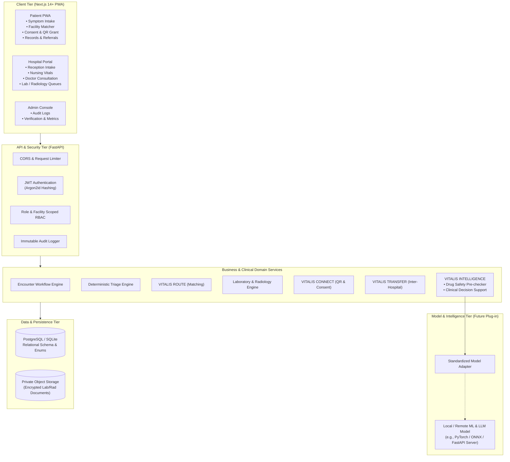
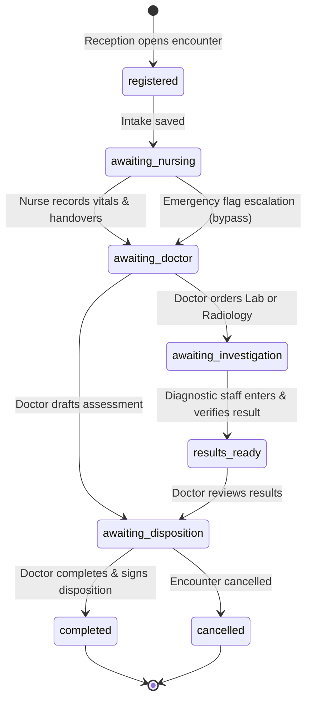
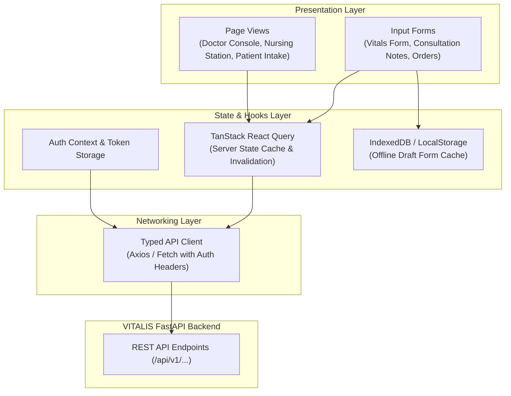
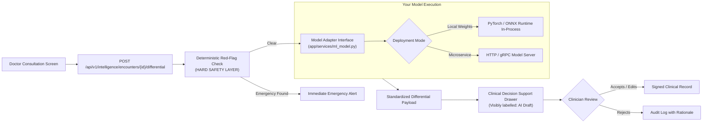

# VITALIS — The Intelligent Healthcare Coordination Network
## Complete Technical Architecture & System Blueprint
**Competition Prototype • Startup-Ready Foundation • ITDC 2026**

---

## 1. Executive Summary & Architectural Philosophy

**VITALIS** is an AI-assisted healthcare coordination platform designed to bridge two critical fragmentation gaps in African healthcare delivery:
1. **External Fragmentation (Patient-to-Facility):** Navigating patients to facilities that actually provide the needed service with verified availability, enabling consent-based record portability, and managing inter-facility referrals.
2. **Internal Fragmentation (Department-to-Department):** Unifying Reception, Nursing, Doctor/Consultation, and Laboratory/Radiology under a **single centralized patient encounter** with role-based access, auditable handoffs, and clinical decision support.

### Core Architectural Principles
- **Patient Safety Before Automation:** Deterministic, clinician-reviewed rules govern emergency escalation; language models and ML models provide draft decision support only and never diagnose or prescribe autonomously.
- **Single Encounter Lifecycle:** Departmental records are linked to a single encounter UUID rather than isolated departmental software systems.
- **Privacy & Consent by Design:** Zero medical history is encoded into QR codes; high-entropy tokens backed by SHA-256 server hashes protect patient data.
- **Modular Monolith Foundation:** Clear domain boundaries allow rapid competition deployment and clean future microservice extraction.

---

## 2. End-to-End System Architecture



---

## 3. Backend Architecture

The backend is built with **FastAPI**, **SQLAlchemy ORM**, **Pydantic v2**, and **PostgreSQL/SQLite**.

### 3.1 Repository Structure
```text
backend/
├── app/
│   ├── main.py                     # FastAPI application setup & router registration
│   ├── core/
│   │   ├── config.py               # Pydantic BaseSettings & environment configs
│   │   ├── database.py             # SQLAlchemy engine & session dependency
│   │   ├── security.py             # Argon2 password hashing, JWT creation & token utils
│   │   └── seed.py                 # Seed script with realistic Abeokuta clinical data
│   ├── models/
│   │   └── models.py               # 20+ SQLAlchemy relational entities
│   ├── schemas/
│   │   └── schemas.py              # Pydantic v2 validation models
│   ├── api/
│   │   ├── deps.py                 # User, Staff, and RBAC security dependencies
│   │   └── endpoints/              # Modular REST routers
│   │       ├── auth.py             # Login, register, profile
│   │       ├── encounters.py       # Centralized 4-department hospital workflow
│   │       ├── diagnostics.py      # Lab & Radiology queues and verification
│   │       ├── triage.py           # Symptom intake & emergency rules
│   │       ├── facilities.py       # ROUTE suitability facility matcher
│   │       ├── referrals.py        # External facility referral management
│   │       ├── connect.py          # Consent & secure single-use QR access
│   │       ├── intelligence.py     # Differentials & drug safety checker
│   │       ├── transfers.py        # Inter-hospital portable health packages
│   │       ├── patients.py         # Patient profile & family history
│   │       └── admin.py            # Audit event viewer & high-level analytics
│   ├── engines/
│   │   ├── matching/matcher.py     # Suitability score S = 0.40C + 0.25A + 0.20D + 0.15V
│   │   └── triage/rules.py         # Deterministic red flags & vital sign thresholds
│   └── services/
│       ├── audit.py                # Append-only audit logging
│       ├── intelligence.py         # Decision support & differential synthesis
│       ├── medication_safety.py    # Curated allergy & drug-drug interaction checker
│       └── qr_service.py           # High-entropy QR code data URI generation
├── tests/
│   └── test_vitalis_api.py         # 7 comprehensive end-to-end integration tests
├── .env.example
├── .gitignore
└── requirements.txt
```

### 3.2 Centralized Hospital Workflow & State Model

The hospital workflow coordinates Reception, Nursing, Doctor, and Diagnostics around one shared encounter:



### 3.3 Algorithmic Core

#### 1. VITALIS ROUTE — Facility Matching Formula
$$S = 0.40C + 0.25A + 0.20D + 0.15V$$
- **$C$ (Service Compatibility):** Excludes facilities that cannot provide the essential service.
- **$A$ (Reported Availability):** $\text{Available}=100$, $\text{Limited}=60$, $\text{Unknown}=30$, $\text{Unavailable}=0$.
- **$D$ (Distance Suitability):** Haversine distance decay function (higher score for closer facilities).
- **$V$ (Verification & Data Freshness):** Baseline score decayed if reported status is older than 24h or 48h.

#### 2. VITALIS CONNECT — Cryptographic QR Identity
- High-entropy, short-lived (5–10 min) random token.
- Server stores only $\text{SHA-256}(\text{token})$.
- Zero patient medical data encoded into the QR code.
- Enforces single-use redemption, scope restrictions, and instant patient revocation.

---

## 4. Frontend Architecture (Next.js 14+ PWA)

The frontend is designed as a **modern Progressive Web App (PWA)** using **Next.js App Router**, **TypeScript**, **Tailwind CSS**, and **shadcn/ui**. It supports both patient mobile self-service and high-density desktop hospital workstations.

### 4.1 Recommended Repository Structure

```text
frontend/
├── app/
│   ├── layout.tsx                   # Root HTML shell, fonts (Inter), Theme & Toast providers
│   ├── page.tsx                     # Landing page with VITALIS vision & navigation
│   ├── (auth)/
│   │   ├── login/page.tsx           # Unified login with role detection
│   │   └── register/page.tsx        # Patient self-registration
│   ├── patient/                     # Patient PWA Experience
│   │   ├── layout.tsx               # Mobile-first bottom tab navigation
│   │   ├── dashboard/page.tsx       # Health overview, upcoming visits, active referrals
│   │   ├── triage/page.tsx          # Guided symptom intake wizard with red-flag banners
│   │   ├── facilities/page.tsx      # VITALIS ROUTE facility search & suitability cards
│   │   ├── qr-share/page.tsx        # Scoped consent picker & live QR code generator
│   │   ├── records/page.tsx         # Longitudinal medical timeline & diagnostic results
│   │   └── transfers/page.tsx       # Inter-hospital transfer approval & status tracker
│   ├── hospital/                    # Hospital Staff Workspaces
│   │   ├── layout.tsx               # Hospital top-bar (facility switcher, staff badge)
│   │   ├── dashboard/page.tsx       # Real-time department queue counters & hospital alerts
│   │   ├── reception/page.tsx       # Fast patient lookup, intake form, walk-in registration
│   │   ├── nursing/page.tsx         # Triage queue, vital sign entry with instant threshold alerts
│   │   ├── doctor/
│   │   │   ├── queue/page.tsx       # Prioritized waiting list (Emergency > Urgent > Routine)
│   │   │   └── encounter/[id]/page.tsx # Consolidated consultation console:
│   │   │                            #  - Patient intake & vital sign trends
│   │   │                            #  - AI-assisted differential diagnosis drawer
│   │   │                            #  - Real-time drug-allergy pre-check
│   │   │                            #  - Lab & Radiology ordering modal
│   │   ├── diagnostics/page.tsx     # Lab & Radiology work queue, result entry & verification
│   │   └── transfers/page.tsx       # Inter-hospital incoming/outgoing package management
│   └── admin/                       # Platform Governance
│       ├── page.tsx                 # High-level operational throughput analytics
│       └── audit/page.tsx           # Searchable immutable audit log viewer
├── components/
│   ├── ui/                          # shadcn/ui primitives (Button, Card, Dialog, Badge, Input)
│   ├── shared/
│   │   ├── Header.tsx               # Global responsive header
│   │   ├── StatusBadge.tsx          # Consistent color coding for encounter & order statuses
│   │   ├── OfflineBanner.tsx        # Connectivity indicator (Online / Offline mode)
│   │   └── AuditEventItem.tsx       # Reusable audit trail timeline item
│   ├── patient/
│   │   ├── TriageWizard.tsx         # Step-by-step symptom collector
│   │   ├── FacilityCard.tsx         # Suitability score breakdown & distance indicator
│   │   └── QRDisplayModal.tsx       # High-contrast QR code display with countdown timer
│   └── hospital/
│       ├── EncounterTimeline.tsx    # Chronological department handoff history
│       ├── VitalSignsInput.tsx      # Numeric inputs with immediate color-coded threshold badges
│       ├── DifferentialAssistant.tsx# AI draft differential drawer (Accept / Edit / Reject)
│       └── OrderInvestigationModal.tsx # Clinician test order dialogue
├── hooks/
│   ├── useAuth.ts                   # Token storage, role decoding, and route guards
│   ├── useEncounter.ts              # Encounter state synchronization & queue polling
│   ├── useOfflineSync.ts            # Service Worker status & optimistic local storage drafts
│   └── useVitalAlerts.ts            # Client-side validation of vital sign warning thresholds
├── lib/
│   ├── api-client.ts                # Typed Axios / Fetch wrapper with auto Bearer token injection
│   ├── constants.ts                 # Service codes, department lists, threshold constants
│   └── utils.ts                     # Formatting dates, distance strings, and Tailwind class merging
└── types/
    ├── api.ts                       # TypeScript interfaces mirroring Pydantic backend schemas
    └── auth.ts                      # UserRole, TokenPayload, SessionState
```

### 4.2 Frontend State Management & Data Flow



### 4.3 UI Design System & Aesthetic Principles

- **Color Palette:**
  - **Primary:** Deep Emerald Green (`#064e3b` / `#059669`) — signifies trust, clinical authority, and calm.
  - **Secondary:** Mint Accent (`#10b981` / `#a7f3d0`) — highlights positive statuses and verified badges.
  - **Urgent / Emergency:** Warning Amber (`#d97706`) and Restrained Crimson (`#dc2626`) — reserved strictly for abnormal vital thresholds and emergency flags.
  - **Background / Surfaces:** Clean White (`#ffffff`) and Slate Gray (`#f8fafc` / `#f1f5f9`).
- **Typography:** Inter or System Sans-serif, optimized for maximum legibility on low-cost mobile screens.
- **Low-Connectivity Readiness:**
  - PWA Service Worker caches the application shell.
  - Clear `Offline` banner warns users when actions require server connectivity.
  - Client-side draft saving prevents nurses and doctors from losing observation notes during intermittent Wi-Fi drops.

---

## 5. External Machine Learning Model Integration Guide

When you are ready to plug in your AI/ML model, follow this integration contract.

### 5.1 Architecture of the Model Boundary



### 5.2 Python Adapter Implementation

Create [`app/services/ml_model.py`](file:///c:/Users/USER/Desktop/NCS%20backend/app/services/ml_model.py):

```python
from typing import List, Dict, Any

class VitalisMLModelAdapter:
    """Wrapper for external machine learning / NLP clinical model."""
    
    @classmethod
    def predict_differentials(
        cls,
        complaint: str,
        vitals: Dict[str, Any],
        patient_context: Dict[str, Any]
    ) -> List[Dict[str, Any]]:
        """
        Execute model inference and return formatted differential candidates.
        """
        # Call your model here (local PyTorch model or requests.post to your model service)
        return [
            {
                "condition": "Severe Plasmodium Falciparum Malaria",
                "ranking": 1,
                "confidence_signal": "0.92 (High clinical suspicion)",
                "suggested_tests": ["Malaria RDT", "Thick Blood Film", "Full Blood Count"]
            },
            {
                "condition": "Enteric (Typhoid) Fever",
                "ranking": 2,
                "confidence_signal": "0.68 (Moderate suspicion)",
                "suggested_tests": ["Blood Culture", "Stool Culture"]
            }
        ]
```

Hook it into [`app/services/intelligence.py`](file:///c:/Users/USER/Desktop/NCS%20backend/app/services/intelligence.py):
```python
from app.services.ml_model import VitalisMLModelAdapter

# Inside generate_encounter_differential:
if settings.MODEL_PROVIDER == "external-ml-model":
    differentials = VitalisMLModelAdapter.predict_differentials(
        complaint=complaint,
        vitals=vital_summary,
        patient_context={"dob": patient.dob, "gender": patient.gender}
    )
```

Enable it in `.env`:
```env
MODEL_PROVIDER="external-ml-model"
```

---

## 6. Verification & Competition Acceptance Matrix

| Module | Acceptance Criteria | Verified |
|---|---|---|
| **Auth & RBAC** | Password hashing with Argon2; role-based route protection across 8 user roles. | **Yes** (Automated Test) |
| **Reception** | Assisted registration, unique encounter numbering, intake recording, walk-in/referred modes. | **Yes** (Automated Test) |
| **Nursing** | Vital sign recording, threshold warnings (temp, BP, SpO2), automated queue handover. | **Yes** (Automated Test) |
| **Doctor** | Consolidated encounter review, consultation notes, diagnostic test ordering. | **Yes** (Automated Test) |
| **Diagnostics** | Laboratory & Radiology queues, result entry, professional verification workflow. | **Yes** (Automated Test) |
| **VITALIS ROUTE** | Suitability matching formula $S = 0.40C + 0.25A + 0.20D + 0.15V$ with freshness decay. | **Yes** (Automated Test) |
| **VITALIS AI** | Deterministic red flags trigger `EMERGENCY_RED` immediately without LLM delay. | **Yes** (Automated Test) |
| **Drug Safety** | Pre-computation allergy check (e.g., penicillin cross-sensitivity) and major drug interactions. | **Yes** (Automated Test) |
| **CONNECT (QR)** | Single-use high-entropy token, SHA-256 storage, single redemption, instant revocation. | **Yes** (Automated Test) |
| **TRANSFER** | Portable manifest assembly, patient consent recording, 24h token dispatch, receiving redemption. | **Yes** (Automated Test) |
| **Audit** | Append-only audit logs recording actor, IP, timestamp, and sensitive clinical actions. | **Yes** (Automated Test) |

---

## 7. Next Steps for the Team

1. **Push Backend to Remote:**
   ```powershell
   git push -u origin main
   ```
2. **Start Backend Server:**
   ```powershell
   python -m uvicorn app.main:app --reload --port 8000
   ```
3. **Initialize Frontend Repository:**
   - Scaffold the Next.js 14+ PWA shell (`npx create-next-app@latest frontend --typescript --tailwind --app`).
   - Use the directory structure and API contracts defined in Section 4.
4. **Model Integration:**
   - Plug your model into `app/services/ml_model.py` when your weights and inference harness are ready.
